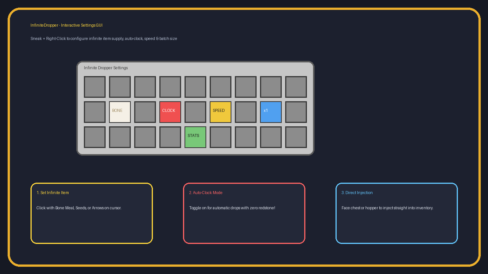
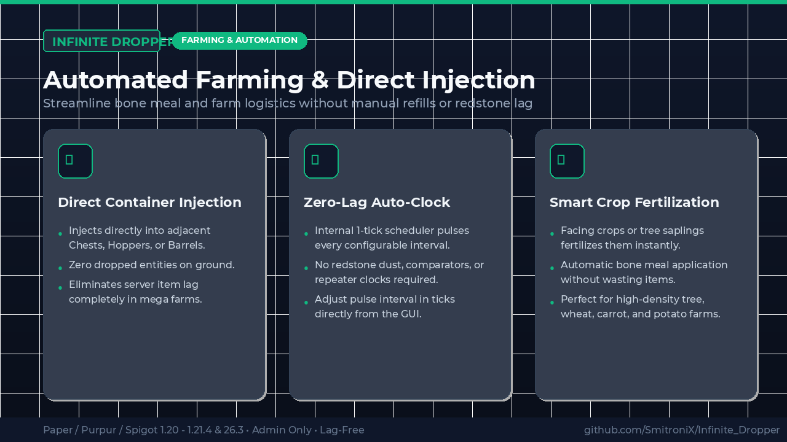
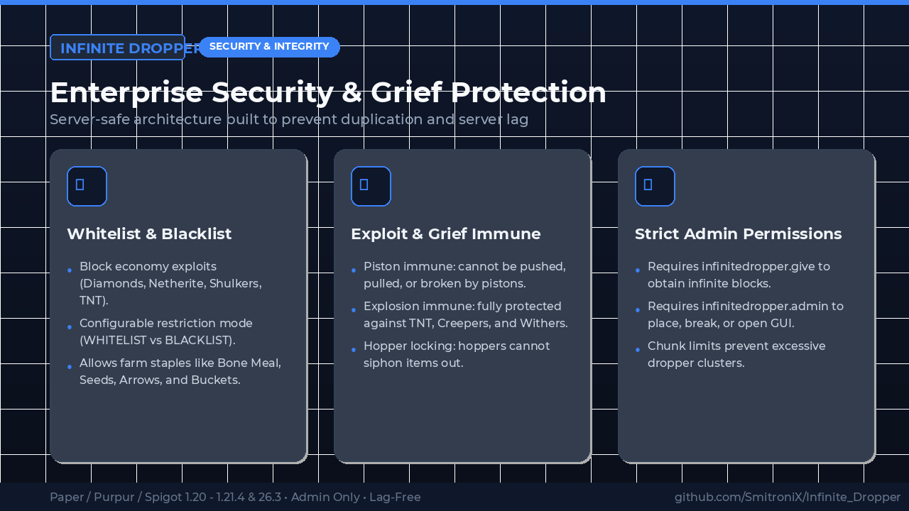

# InfiniteDropper 🔄

<div align="center">
  
  <p><strong>A high-performance, administrator-controlled Infinite Dropper & Dispenser plugin for Paper, Purpur, Spigot, and Folia (Minecraft 1.20 - 1.21.4+ / 26.3).</strong></p>

  [](https://modrinth.com/plugin/infinite-dropper)
  [](https://github.com/SmitroniX/Infinite_Dropper/releases)
  [](#)
  [](https://github.com/SmitroniX)
  [](#)
</div>

---

## 📖 Overview

Tired of constantly refilling bone meal, seeds, or arrows in your automated farm systems?  
**InfiniteDropper** provides server administrators and technical farm builders with an efficient, lag-free solution: **Infinite Droppers & Dispensers** that output items without ever depleting.

Designed with high-scale technical servers in mind, it features an **Internal Auto-Clock** (eliminating laggy comparator loops), **Direct Container Injection** (zero floating item entities), and a **Sneak + Right-Click Configuration GUI**.

---

## ✨ Features

- **🔄 Unlimited Auto-Replenishing Supply:** Place or select an allowed item (e.g. Bone Meal). Every pulse dispenses the item while instantly locking and replenishing the stack at 64 so it never runs out.
- **⏱️ Built-in Auto-Clock (Zero Redstone Lag):** Toggleable internal pulsing mode dispenses automatically every set interval (e.g. 0.5s, 1s, 2s) with **no redstone wiring or comparator loops needed**.
- **📦 Direct Container Injection:** Facing a Chest, Hopper, or Barrel directly injects the items straight into the container instead of dropping loose entities on the ground.
- **🌾 Smart Kelp & Crop Fertilization:** Facing underwater **Kelp**, **Sugar Cane**, **Bamboo**, or crops directly fertilizes and grows them on each pulse without wasting items.
- **⚙️ Interactive GUI with In-Menu Item Selector:** Sneak + Right-Click to open a custom settings menu. Click Slot 10 to open a 54-slot **Allowed Item Selector** to pick Bone Meal, Seeds, or Arrows with a single click, or click any item in your player inventory!
- **⚡ In-World Auto-Conversion:** Server admins can Sneak + Right-Click **any** vanilla dropper or dispenser in the world to convert it into an Infinite block on the fly!
- **🔔 Automatic Update Alert System:** Checks Modrinth and GitHub for new releases asynchronously on startup and reload. Notifies admins and operators in chat upon joining with clickable update links.
- **🛡️ Strict Item Restrictions (Whitelist & Blacklist):** Disallows high-value items (Diamonds, Netherite, Shulkers, TNT) to prevent economy duplication while allowing farm essentials.
- **💥 Grief & Exploit Immune:** Immune to explosions (TNT, Creepers, Withers) and cannot be pushed/pulled by pistons.
- **🔒 Admin-Only Access:** Non-admins cannot give, place, break, or tamper with Infinite Droppers.

---

## 📸 Showcase Gallery

<div align="center">
  
  <br/><br/>
  
  <br/><br/>
  
</div>

---

## 🎮 Commands & Permissions

| Command | Permission | Description |
|---|---|---|
| `/id give <player> [dropper\|dispenser] [amount]` | `infinitedropper.give` | Give custom glowing infinite blocks |
| `/id reload` | `infinitedropper.admin` | Reload configuration |
| `/id help` | `infinitedropper.admin` | View commands and help |

*Full admin permission node:* `infinitedropper.admin` (Default: OP)

---

## 🚀 Quick Start Guide

1. Give yourself an infinite block:
   ```
   /id give SmitroniX_Yt dropper 1
   ```
   *(Or `/id give SmitroniX_Yt dispenser 1`)*
2. Place the block facing your farm, chest, or hopper.
3. Sneak + Right-Click the block with an empty hand to open the GUI.
4. Click with **Bone Meal** on your cursor to set the supply.
5. Click **Auto-Clock** to toggle automatic pulsing on!

---

## ⚙️ Configuration (`config.yml`)

```yaml
# Restriction Mode: WHITELIST or BLACKLIST
restriction-mode: "WHITELIST"

whitelist:
  - BONE_MEAL
  - WHEAT_SEEDS
  - CARROT
  - POTATO
  - PUMPKIN_SEEDS
  - MELON_SEEDS
  - BEETROOT_SEEDS
  - ARROW
  - WATER_BUCKET
  - FIREWORK_ROCKET
  - DIRT
  - COBBLESTONE

auto-clock:
  enabled: true
  default-interval-ticks: 20
  min-interval-ticks: 5

direct-container-injection: true

protection:
  piston-immune: true
  explosion-immune: true
  admin-only-open: true
  max-per-chunk: 8

effects:
  particles: true
  sounds: true

# Automatic Update Alerts
update-checker:
  enabled: true
  notify-admins-on-join: true
```

---

## 📥 Downloads

* **Modrinth:** [https://modrinth.com/plugin/infinite-dropper](https://modrinth.com/plugin/infinite-dropper)
* **GitHub Releases:** [Download Latest JAR](https://github.com/SmitroniX/Infinite_Dropper/releases/latest)

---

## 🐛 Bug Reports & Support

Encountered an issue or have a feature request?  
Open an issue on the [GitHub Issue Tracker](https://github.com/SmitroniX/Infinite_Dropper/issues).

---

## 👨‍💻 Author & Developer

* **Lead Developer:** **Smitronix** ([GitHub @SmitroniX](https://github.com/SmitroniX))
* **Repository:** [SmitroniX/Infinite_Dropper](https://github.com/SmitroniX/Infinite_Dropper)

---

## 📄 License

Distributed under the MIT License. Copyright (c) 2026 Smitronix.
